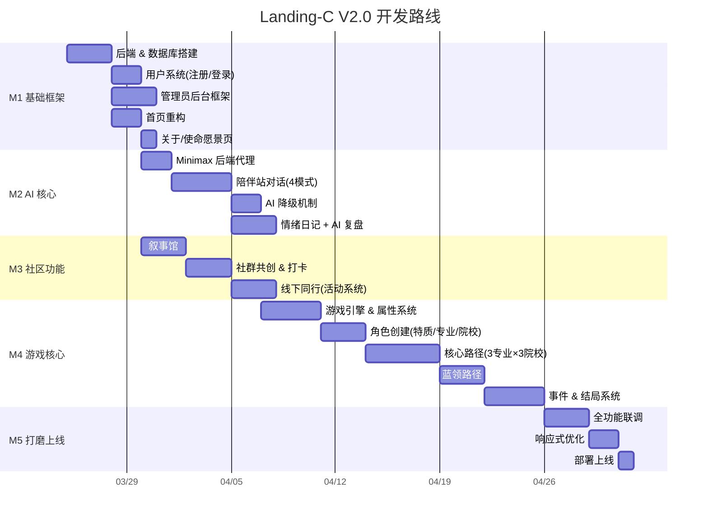

# Landing-C V2.0 开发 Roadmap

> 基于 PRD v0.3 | 2026-03-24

---

## 总览

---

## M1 — 基础框架（地基） ✅

> 目标：搭建可运行的后端 + 用户系统 + 管理后台 + 前端页面骨架

| # | 任务 | 产出 | 依赖 |
|---|------|------|------|
| 1.1 | **Node.js 后端初始化** ✅ | 项目结构、路由、SQLite 连接、基础中间件 | — |
| 1.2 | **数据库设计** ✅ | users / diaries / stories / activities / game_saves 等表 | 1.1 |
| 1.3 | **用户注册/登录 API** ✅ | POST /register, POST /login, JWT 鉴权 | 1.2 |
| 1.4 | **延迟注册前端组件** ✅ | 通用注册弹窗（在需要时触发） | 1.3 |
| 1.5 | **管理员后台框架** ✅ | 后台页面骨架 + 用户列表/搜索/禁用 | 1.3 |
| 1.6 | **首页重构** ✅ | 产品入口式首页（Hero + 6 功能卡 + 动态 + Footer） | 1.1 |
| 1.7 | **关于/使命愿景页** ✅ | 迁移 Demo 内容（真实声音/数据/五周计划/旅程/团队） | 1.6 |

---

## M2 — AI 核心（灵魂） ✅

> 目标：接入真实 AI 对话，实现智能陪伴 + 情绪日记 + AI 复盘

| # | 任务 | 产出 | 依赖 |
|---|------|------|------|
| 2.1 | **Minimax API 后端代理** ✅ | POST /api/chat → 转发 Minimax，保护 Key | M1.1 |
| 2.2 | **陪伴站对话前端** ✅ | 自由输入聊天 UI（替代 Demo 选择式） | 2.1 |
| 2.3 | **智能策略 Prompt** ✅ | 系统提示词：自由陪伴 / IFS / CBT / 教练 自动切换 | 2.2 |
| 2.4 | **AI 降级机制** ✅ | API 异常检测 → 预设对话 + 离线练习 | 2.3 |
| 2.5 | **情绪日记** ✅ | 心情选择 + 文字记录 + 趋势图 | M1.3 |
| 2.6 | **AI 日记复盘** ✅ | 提交日记后 AI 生成洞察/模式识别/建议 | 2.1, 2.5 |

---

## M3 — 社区功能（连接） ✅

> 目标：完成叙事馆、社群共创、线下活动系统

| # | 任务 | 产出 | 依赖 |
|---|------|------|------|
| 3.1 | **叙事馆 CRUD** ✅ | 发布/浏览/共情 API + 前端 | M1.3 |
| 3.2 | **内容审核** ✅ | AI 预审（调 Minimax）+ 后台人工复核 | 3.1, M1.5 |
| 3.3 | **社群共创** ✅ | 打卡任务 + 微光积分 + 互助小组匹配 | M1.3 |
| 3.4 | **活动系统** ✅ | 创建/报名/审核（管理员 + 普通用户均可发布） | M1.3, M1.5 |
| 3.5 | **活动回顾** ✅ | 图文发布功能 | 3.4 |

---

---

## M4 — 游戏核心（亮点） ✅

> 目标：完成"人生路径"游戏的核心可玩循环

| # | 任务 | 产出 | 依赖 |
|---|------|------|------|
| 4.1 | **游戏引擎** ✅ | 属性系统、回合机制、事件触发器、路径判定器 | — |
| 4.2 | **角色创建 UI** ✅ | 选特质 + 选起点 + 选院校 + 选专业 | 4.1 |
| 4.3 | **属性面板 UI** ✅ | 实时显示能力值/喜悦/健康/经济 | 4.1 |
| 4.4 | **路径锁定逻辑** ✅ | 职业院校锁定学术路径 + 灰显 + 原因说明 | 4.1 |
| 4.5 | **核心路径剧本** ✅ | 3 专业（计算机/法律/语言）× 3 院校 | 4.1 |
| 4.6 | **蓝领路径剧本** ✅ | 技术蓝领/新蓝领/工程技术/专升本/技术创业/自学成才 | 4.4 |
| 4.7 | **事件库** ✅ | 随机/职业/家庭/健康/情绪/专业事件（JSON） | 4.1 |
| 4.8 | **结局系统** ✅ | 成功/中性/失败/隐藏结局 + 结算面板 | 4.1 |
| 4.9 | **AI 叙事增强** ✅ | AI 生成事件描述 + 降级策略 | M2.1, 4.7 |
| 4.10 | **存档系统** ✅ | 3 个存档位 + 存档/读档 API | M1.3, 4.1 |
| 4.11 | **教育联动** ✅ | 喜悦低→陪伴站 / 迷茫→工具箱 跳转引导 | M2.2 |

---

## M5 — 全功能联调与部署 ✅

| # | 任务 | 产出 | 依赖 |
|---|------|------|------|
| 5.1 | **全链路联调** ✅ | 注册-陪伴-社区-打卡全路径跑通 | M1-M3 |
| 5.2 | **游戏模块修复** ✅ | 修复：开始模拟按钮无法触发 (ID 匹配同步) | M4 |
| 5.3 | **最终回归测试** ✅ | 跑通包含游戏在内的全链路流程 | 5.1, 5.2 |
| 5.4 | **响应式优化** ✅ | 移动端交互微调 (三大主样式表) | 5.3 |
| 5.5 | **部署上线准备** ✅ | .env 配置与安全加固 (Helmet+限流) | 5.4 |

---

## 后续迭代计划 (M6 — M8) ✅

### M6 — 游戏内容深度扩充 (已验证)
| # | 任务 | 产出 | 状态 |
|---|------|------|------|
| 6.1 | **新增专业** | 土木/医学/设计/商科/数理化 | [x] |
| 6.2 | **事件树加深** | 考公/留学/Gap/职场进阶等 8-10 层深度 | [x] |
| 6.3 | **隐藏结局** | 特定组合触发特殊成就 (如草根逆袭) | [x] |
| 6.4 | **随机事件池** | 30+ 日常随机事件概率触发 | [x] |
| 6.5 | **AI 动态叙事** | 结合当前属性动态生成剧情描述 | [x] |

### M7 — 数据分析与留存 (已验证)
| # | 任务 | 产出 | 状态 |
|---|------|------|------|
| 7.1 | **行为埋点** | 自动记录用户关键路径 (user_events) | [x] |
| 7.2 | **情绪趋势大盘** | 管理后台全站心情分布图表 | [x] |
| 7.3 | **游戏热力图** | 管理后台统计路线选择频率 | [x] |
| 7.4 | **用户画像标签** | 自动化打标签 (容易焦虑/创意型等) | [x] |
| 7.5 | **A/B 测试** | 对话 Prompt A/B 灰度测试能力 | [x] |

### M8 — 社交系统加强 (已验证)
| # | 任务 | 产出 | 状态 |
|---|------|------|------|
| 8.1 | **同频匹配 2.0** | 根据日记/游戏轨迹/标签推荐好友 | [x] |
| 8.2 | **AI 会话记忆** | 保持最近 20 条对话上下文 | [x] |
| 8.3 | **匿名 1v1 聊天** | 好友匹配后的限时安全私信 | [x] |
| 8.4 | **优点清单共创** | 社群内成员互相评价优点 | [x] |
| 8.5 | **通知系统** | 站内信/提醒打卡与活动 | [x] |

### M9 — 工程化与生产化 (待启动)
PM2 进程守护、PWA 改造、Nginx 反代、自动化备份。
